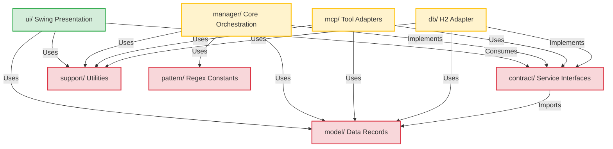

# Architectural Design Review: NetBeans Coding Assistant Plugin

This document describes the architecture of the **Coding Assistant** NetBeans IDE plugin (current stable line v1.30.x, artifactId `beanbot`). The plugin bridges the NetBeans Platform with an AI subprocess using the **Agent Client Protocol (ACP) v1** via JSON-RPC over stdin/stdout and Server-Sent Events (SSE) streaming. It also exposes an embedded **MCP (Model Context Protocol) server** so the AI can call back into the IDE.

Source layout (385 Java files under `src/main/java/github/anandb/netbeans/`):

| Package | Files | Role |
| --- | --- | --- |
| `contract/` | 29 | Ports: UI callbacks, session & process control, permission/request handlers, stores, tool executor |
| `db/` | 8 | H2 persistence adapter: usage stats, session store, pin/model-list caches, SQL loader, preference migration |
| `manager/` | 26 | Core orchestration: protocol client, session/process lifecycle, strategy dispatch, caches, update checker |
| `mcp/` | 44 | Embedded MCP server and tool providers (editor, filesystem, VCS, tasks, project, stash diff) |
| `model/` | 31 | ACP data records (session, messages, updates, config options, usage rows, harness catalog) |
| `pattern/` | 40 | Compiled regex constants with no dependencies; consumed by every layer |
| `project/` | 12 | NetBeans lifecycle hooks, open-project manager, markdown project type |
| `support/` | 41 | Pure utilities: logging, JSON, text scanning, preference keys, file-access policy, binary resolution |
| `tasks/` | 17 | todo.txt task repository integration (bugtracking providers, issue cache, task editors) |
| `ui/` | 137 | Swing presentation, grouped by feature (`assistant`, `chat`, `composer`, `session`, `permission`, `options`, `rendering`, `components`, `editor`, `export`, `stats`, `platform`, `mdproject`) |

---

## 1. Architectural Summary & Strengths

The codebase implements a **Hexagonal (Ports & Adapters)** design adapted to the NetBeans rich-client module environment. Dependencies flow downward only:



`project/`, `mcp/`, `tasks/`, `db/`, and `pattern/` sit outside the five-layer model: `project/` is NetBeans lifecycle wiring, `mcp/` is the tool-serving adapter surface, `tasks/` is a self-contained bugtracking feature, `db/` is the H2 persistence adapter, and `pattern/` is a dependency-free regex-constant satellite imported by every layer.

### Key Architectural Strengths

| Design Aspect | Implementation | Benefits |
|---|---|---|
| **Hexagonal Isolation** | Direct presentation (`ui/`) → logic (`manager/`) dependencies are banned. The UI interacts only with `contract/` interfaces. Verified: zero `ui/→manager`, `ui/→mcp`, `manager/→ui`, `project/→ui`, or lower→higher imports. | High testability; logic/protocol swaps can be done without modifying Swing components. |
| **Loose Platform Coupling** | NetBeans lookup APIs (`Lookup.getDefault()`), preferences, and project managers are abstracted behind the `ui/platform/PlatformBridge` adapter and its sub-services (`SessionService`, `ProcessService`, `PrefStore`, `Bundle`, `ProjectContext`), resolved via `@ServiceProvider` + `*Safe()` fallback proxies. `ui/` code uses `PlatformBridge.sessionControl()`, `processControl()`, `serviceSafe(Class)`, and `prefStoreSafe()`; only the bridge implementation and `SlashCommandInterceptor.intercept(..., Lookup)` still touch NetBeans APIs. | Swing views and message dispatchers run in headless unit tests; platform services are swappable. |
| **Lookup Injection** | Concrete managers are registered as `@ServiceProvider` behind `contract/` interfaces and resolved via NetBeans `Lookup`. | Eliminates UI static coupling and enforces compile-time boundary constraints. (`SessionManager` retains a `getInstance()` legacy accessor used by tests; the UI consumes it via `SessionControl`.) |
| **Explicit Satellite Layers** | `db/` owns all H2 access behind `contract/UsageStatsStore` / `SessionStore` / `PinnedMessageControl` / `ModelListControl`; `pattern/` holds pre-compiled patterns. | Persistence and hot-path regex stay out of `manager/`/`ui/`, keeping the layering honest. |

---

## 2. Asynchrony, Concurrency & EDT Safety

In Swing applications, managing background processes (like the `opencode acp` execution) without freezing the Event Dispatch Thread (EDT) is critical:

### The SSE → EDT Session Race Guard
When streaming updates (`agent_message_chunk`, `tool_call`, …) arrive, network latency can mean chunks arrive after the user switched sessions.
- **Guard**: `ui/session/SessionLifecycleHandler.displayMessage()` captures the active session ID *before* scheduling the EDT callback with `SwingUtilities.invokeLater()`.
- **Validation**: the EDT task re-verifies the session ID; stale updates from inactive sessions are silently dropped, preventing message bleed.
- **Plan panel**: `updatePlan` is deliberately *not* gated by the same capture guard, because the harness replay re-populates it while the session is LOADING; it clears on session start and `onSessionLoading(true)`.

### Debounced Toolbar Actions
- The New Session toolbar button uses a **300 ms debounce timer** (`ui/assistant/ChatLayoutBuilder`) to prevent double-clicks spawning concurrent initialization.
- `Ctrl+L` is unrelated to New Session — it toggles the sidebar via `ui/assistant/ToggleAssistantAction`.

### Off-EDT I/O
- No file/network/pipe I/O runs on the EDT: `AcpProtocolClient.sendRequest()`/`sendNotification()` use `CompletableFuture.runAsync()`.
- `ui/editor/StashDiffAction` runs `git`/`hg` in a `RequestProcessor`, uses `proc.waitFor(timeout)` and always `waitFinished` before consuming output.
- `ACPOptionsPanel` probes WSL on its own `RequestProcessor`, not the EDT.
- `ProjectPaths.nativePath(...)` converts project directories to native OS paths before any `cwd` is sent to the harness.

---

## 3. UI Rendering & Performance Optimizations

Updating rich Swing components during rapid SSE streaming is expensive. The plugin uses a multi-tier rendering strategy:

```
                  ┌────────────────────────────────────────┐
                  │          Incoming Markdown             │
                  └──────────────────┬─────────────────────┘
                                     │
                    Is it streaming tool/thought text?
                    ├── Yes ──> [MarkdownStyledRenderer]
                    │           • Bypasses HTML engine
                    │           • Inserts ranges via SimpleAttributeSet
                    │           • Extremely fast, zero layout rebuilds
                    │
                    └── No ───> [FitEditorPane] (Full Bubble)
                                • Renders complete HTML/CSS
                                • Reuses Document (doc.remove() + kit.read())
                                • Caffeine LRU cache for markdown conversion
```

1. **`ui/rendering/MarkdownStyledRenderer`**: streaming thoughts, tool activity, raw logs. Bypasses Swing's HTML engine, parsing tokens directly into a `JTextPane` with `SimpleAttributeSet`.
2. **`ui/rendering/FitEditorPane`**: finalized chat bubbles needing nested lists, code highlights, and links. Reuses the HTML `Document` instead of rebuilding layout trees.
3. **Streaming pipeline**: `ui/chat/StreamingCoordinator` drives per-bubble updates every `TimingConstants.STREAM_FLUSH_MS` (80 ms); `ChatThreadPanel`'s non-repeating flush timer finalizes streaming when chunks stop. `ui/rendering/HtmlContentPreparer` caches markdown→HTML in a Caffeine cache (256 entries); content >32 KB bypasses it.
4. **Collapsible panes** (`ui/chat/BaseCollapsiblePane`) cache preferred/maximum size and clear both on invalidation; expand/collapse repaints the enclosing viewport after the queued validate so BLIT scrolling does not leave blank strips.
5. **Auto-scroll contract** (`ui/chat/ScrollController`): a 150 px sticky zone; every content-modifying call captures `wasAtBottom` *before* touching content, and auto-scroll only fires when it was true.

---

## 4. Memory Management & Lifecycle Cleanup

Memory leaks are a common failure point for long-running IDE components:
- **Timer and stream disposal**: overridden `removeNotify()` calls in UI components stop Swing `Timer`s and finalize streaming buffers.
- **Persistent MouseListeners**: in `BaseCollapsiblePane`, listeners capturing `this` are intentionally not removed — they die with the component tree, and removing/re-adding caused duplicate-toggle bugs.
- **Project-event coalescing**: `support/SlidingTask` collapses burst-prone `OpenProjects` listeners (file-cache rebuilds, project sync, platform-bridge fan-out) into one restartable task instead of a queued run per event.

---

## 5. IDE Integration & Context Actions

Beyond the chat panel, the plugin exposes IDE context actions that route selection context into the assistant:

- **`ui/editor/AssistantTarget` (router)**: decides where "Send to Assistant" / "Ask Assistant" delivers its payload. Based on the cached `MINI_ASSISTANT_ENABLED` preference (`support/PluginSettings`), it opens the floating `ui/assistant/MiniAssistantDialog` or the main `AssistantTopComponent`. This keeps the target decision testable and avoids scattering `PluginSettings` lookups across actions.
- **Context actions** (`ui/editor/SendToAssistantFileAction`, `InspectorContextMenu`, `TestResultsContextMenu`, `AskAssistantRefactorAction`): extract the selection/file subtree, then call `AssistantTarget.showWithText(...)`. They are gated behind the shared "Enable context menu additions" preference. `ui/editor/TreePopupSupport` centralizes copy/send popup behavior shared by Inspector and Test Results.
- **Append semantics**: `showWithText` *appends* to the input area (`AssistantTopComponent.appendInputText`) rather than overwriting, so multiple selections accumulate before sending.
- **AI-driven editor navigation**: MCP/ACP file access opens documents in the background (`EditorCookie.openDocument()` / `Line.show(OPEN, NONE)`) and never steals focus unless the user explicitly asked to be taken there (`focus=true`).
- **Missing-binary state**: `ui/assistant/AssistantTopComponent.setBinaryNotFoundState()` drives the onboarding/install UI; "New Session" stays disabled until a server start succeeds.

### Ctrl+L Toggle & Window Registration
`Ctrl+L` toggles the assistant sidebar. This depends on a specific combination that must not be broken: the `AssistantTopComponent` `@TopComponent.OpenActionRegistration` annotations plus a manual `layer.xml` registration pointing both `Window > Assistant` (`Assistant.shadow`) and `Ctrl+L` (`D-L.shadow`) at `ToggleAssistantAction` (which uses `findInstance()` + `toggleVisibility()`). No `KeyEventDispatcher` intercepts `Ctrl+L`.

---

## 6. MCP Server (Calling the IDE from the AI)

The plugin embeds a **Model Context Protocol (MCP) server** so the AI subprocess can invoke IDE operations:

- **`mcp/McpServer`**: a Jetty EE10 HTTP server bound to `127.0.0.1` on a random (or configured) port, secured by a per-instance bearer token. Started/stopped by `mcp/McpManager` with capability detection and a disable toggle. The connector idle timeout is clamped to a 30 s minimum.
- **Token policy**: `Harness.acceptsMcpAuthToken()` is the single policy; the PI family and Jcode cannot carry a token on the MCP URL, so the server runs without token enforcement for them. `ServerProcessLifecycle` resolves the harness *before* `toolExecutor.start()` sets `authRequired`.
- **Tool registry (`mcp/McpTools`, `McpToolDefinition`, `McpToolAdapter`)**: thread-safe registration/unregistration. `McpToolAdapter` adapts `McpManager` to `contract/ToolExecutor`, keeping `manager/` out of `mcp/` except `ProcessManager`.
- **Tool families**:
  - `EditorToolProvider` — editor context and navigation.
  - `FileSystemToolProvider` — `read_file`, `write_to_file`, `replace_lines`, `insert_in_file`, `delete_lines`, `search_project`, `list_directory`, `run_command`.
  - `GitToolProvider` / `HgToolProvider` — status, diff, log, file history; shared helpers in `mcp/VcsToolSupport`.
  - `TaskToolProvider` — `add_task`, `update_task`, `close_task`, `search_task`.
  - `ProjectToolProvider` — open-project queries.
  - `StashDiffToolProvider` — stash diff inspection.
  - `FindTypeToolProvider` — Java type lookup via the open projects' `ClassIndex`.
- **Path confinement**: every filesystem/git/hg path passes `mcp/ProjectPathGuard`; `support/FileAccessGuard` applies the user's file-access policy (`support/AcpFsPolicy`) plus `support/SecretPaths` (credentials) and `support/ProtectedPaths` (`.git`, `.hg`, `.mvn` writes). `run_command` is gated on its working directory and `support/RunCommandPolicy` allow/deny lists.
- **Failures**: a tool returns `{status:"error", message}` normally; only a real breakage also sets `"fatal": true`, which makes the harness mark the call failed.

---

## 7. Project Lifecycle, Process & Session Management

- **`project/ACPStartup`** (`@OnStart`): defers heavy initialization (preferences migration, update-check start, sidebar open, version-change detection) to a background thread. **`project/ACPShutdown`** (`@OnStop`) stops the process control, the image-paste I/O pool, and the H2 store (`UsageStatsStore.close()`) so an in-place upgrade can re-lock the database. **`project/ACPProjectManager`** caches the open-project list and updates it on open/close events.
- **Process/session (`manager/`)**: `ServerProcessLifecycle` owns start/stop (with WSL support) and captures per-connection capabilities (`close`, `delete`); `SessionStateMachine` drives IDLE → LOADING → STREAMING → STOPPING → IDLE; `AcpReconnectManager` auto-reconnects (3 attempts, 3 s/6 s/9 s, reset after 5 idle minutes); `AcpRequestRouter` routes requests.
- **Request timeouts**: per-request *idle* timeouts tied to the connection's `lastDataTime`, not absolute deadlines (`future.orTimeout`), so in-flight requests survive active streaming. Exception: `initialize` during startup may use an absolute timeout.
- **`session/close` before `session/load`**: sent only when the agent advertised `agentCapabilities.sessionCapabilities.close`, and only when the load target is the session already loaded by the current server process (`shouldCloseBeforeLoad()` compares `loadedSessionId` + `serverGeneration()`). A plain switch skips cancel+close and goes straight to `session/load`.
- **Session rename/delete**: ACP has no rename; `Harness.supportsSessionRename()` (goose only) maps to `_goose/unstable/session/rename`. `session/delete` is gated on the per-connection `delete` capability; a failed or unsupported call keeps the row.
- **Project-switch restart**: `ProcessManager.ensureStartedIn(dir)` rebinds the server's spawn cwd by restarting the process, gated by the *Enable ACP server restart on project switch* preference (read once at startup). The flag always wins, even for harnesses that can move a session's cwd live.
- **`manager/strategy/StrategyRegistry`**: dispatches `session/update` messages (implements `contract/UpdateDispatcher` via `@ServiceProvider`), with Caffeine caches for tool-call dedup, counted messages, and captured usage.

### Turn-end, queue and steer semantics
- End of turn is signalled by `responding_finished` / `end_turn` or the RPC `stopReason`; `available_commands_update` is *not* a turn end.
- `HarnessCatalog.forAgentVersion(harness, version)` derives **OpenCode v2** (`requiresMessageQueue=true`, no mid-turn steering) from the reported agent version while keeping the shared v1 id.
- **goose** rejects a second `session/prompt` while a run is active. `HarnessCatalog.GOOSE` therefore queues by default, and `ProcessManager.steerMessage()` uses `_goose/unstable/session/steer` with an `expectedRunId` from `manager/ActiveRunTracker`; a stale id is retried once from `error.data.actualRunId`. `support/SteerEchoes` suppresses the duplicate user echo.
- **Hermes** has no steering extension: mid-turn text is posted immediately as its `/steer <guidance>` slash command. Hermes answers that prompt within ~20 ms with `stopReason:"end_turn"` **as the steer prompt's JSON-RPC result** (wire-verified in the ACP logs; it sends no turn-end `session/update` while a run is active), so `MessageSender.trySlashSteer` neither bumps the send generation nor wires completion handlers — the ignored result is what keeps the original turn alive, and the original prompt's completion still ends the turn. Attachments and non-steer slash commands fall back to the normal queue.
- **`_session/steering`** is the cross-adapter extension (claude-agent-acp, omp's `acp` mode, and the `@automatalabs`/`@openma`/`@gugu-acp`/`jetbrains-pi-acp` pi adapters; proposal: ACP `session/inject`, agent-client-protocol#1261). It is advertised per connection at top-level `_meta.steering.supported`, captured by `ServerProcessLifecycle` beside `sessionCapabilities.*`, and used by `MessageSender.tryProtocolSteer` before the queue: `support/SteeringRequest` sends `{sessionId, prompt, _meta.steering.idleBehavior=promptRequired}` and only `outcome:"injected"` counts as delivered. `promptRequired`/`startedNewTurn` restore the text and attachments; omp's `failed` is surfaced as an error. The reply carries no message id, so `support/SteerEchoes.expectText` suppresses the `user_message_chunk` that adapters like claude-agent-acp stream back for the injected message. This route also protects omp, whose `session/prompt` implicitly **cancels** the running turn when it arrives mid-turn.
- A failed mid-turn send must not end the turn UI: Stop stays enabled and the turn-end claim is handed back to the original prompt.

---

## 8. Supporting Services, State & Persistence

- **Configuration (`support/GlobalOpencodeConfig`)**: manages `~/.config/opencode/opencode.json`, evaluating REAL_CONTENT / NEEDS_SETUP / UNPARSEABLE, surfaced by `ui/session/GlobalConfigBubble`. **`support/PreferencesMigrator`** migrates preferences from prior user directories.
- **Slash commands**: `contract/SlashCommandProvider` + `manager/DefaultSlashCommandInterceptor` route `/models`, `/model`, `/agents`, `/level`, `/sessions`, `/new`, `/title`, `/archive`, `/compact`. Local slash commands are intercepted before mid-turn routing.
- **File & session caches**: `manager/FileCacheManager` (implements `contract/FileCacheQuery`), eagerly initialized by `FileCacheInitializer`, with VCS ignore strategies (`GitIgnoreStrategy`, `HgIgnoreStrategy`, `NoVcsIgnoreStrategy`, `BbIgnoreStrategy`); `manager/SessionCacheManager` caches session data. `BbIgnoreStrategy` replaces `.gitignore`/`.hgignore` entirely when a project-root `.bbignore` exists.
- **State & messaging**: pins and model lists are persisted by `db/H2UsageStatsStore` behind `contract/PinnedMessageControl` / `ModelListControl` (memory cache + row-level deltas). `manager/strategy/SubAgentTitleResolver` renders `agent_title`/`sub_agent`. `support/Logger` is a session-aware, timestamped logging wrapper; `support/PreferenceKeys` centralizes preference constants.
- **Update checking**: `manager/UpdateCheckerService` (`contract/UpdateCheckerControl`) checks Maven Central in the background (60 s first delay, then a random 16–24 h interval).
- **Image paste**: `ui/composer/ImagePasteTransferHandler` (Wayland clipboard support) delegates I/O to `support/ImagePasteIoProcessor`.
- **Export & history**: `ui/export/ConversationExporter` (Markdown) and `HtmlConversationExporter` (standalone HTML with embedded CSS); `ui/composer/MessageHistory` + `HistorySearchDialog` (store-persisted input history, `Ctrl+Up`); `ui/session/ArchiveSessionAction`.
- **H2 store (`db/`)**: `H2UsageStatsStore` implements `UsageStatsStore`, `SessionStore`, `PinnedMessageControl`, and `ModelListControl` over one H2 database under the NetBeans user directory. Every operation runs on a single-threaded executor; an EDT caller enqueues and returns. SQL lives in `db/schema.sql` and `db/queries.sql`, rendered by `db/Sql`. `SCHEMA_VERSION` is the migration cursor; `db/PrefsMigration` copies input history, session metadata, pins, and model lists out of `NbPreferences` with per-dataset markers.
- **Live context report**: `SessionManager.reportContext` → `SessionRpcClient.reportContext` asks goose (`Harness.supportsContextReport()`) for a tokenizer-based context report; `ui/stats/TokenUsageDialog` shows it. A failed/unsupported report simply omits the block.

---

## 9. UI Permissions, Attachments & Actions

- **Permission flow (`ui/permission/PermissionBubble`, `PermissionRequestPanel`, `PermissionOption`, `PermissionDialogManager`, `AllowPermissionAction`, `contract/PermissionHandler`)**: renders and resolves AI permission requests (allow/deny/always).
- **Attachments (`ui/composer/AttachmentManager`, `AttachmentUiHandler`, `AttachmentBadgeIcon`)**: file attachment support wired through the chat input; a failed send restores the attachments through `AttachmentManager.restore()`.
- **Chat rendering stack (`ui/chat/`)**: `BubbleFactory`, `BubbleThemeApplier`, `BubbleContentRenderer`, `BubbleStreamer`, `MessageBubble`, `BubbleActionBar`, and the collapsible panes (`BaseCollapsiblePane`, `CollapsibleActivityPane`, `CollapsibleCodePane`, `CollapsibleToolPane`, `AccordionGroup`, `BubbleAccordionManager`). `MessageFilterManager`/`TypeFilterApplier` and `ToolThoughtCombiner` shape streamed output.
- **Plan panel**: `ui/chat/PlanPanel` docks at the SOUTH of the thread window (inside `AssistantTopComponent`'s `threadWindow` wrap) and is collapsed by default.
- **Surface features**: `ui/assistant/WelcomeScreen` (session list when none loaded), `ui/session/StatusController` (status bar + thinking animation), `ui/editor/GoToFileDialog` (Ctrl+J, debounced search), `ui/stats/TokenUsageDialog`, `ui/options/KeyboardShortcutsDialog`, `ui/session/ArchiveSessionAction`, and 20+ toolbar/menu action classes (`NewSessionAction`, `RenameSessionAction`, `ReloadSessionAction`, `RestartServerAction`, `StopMessageAction`, `SendMessageAction`, `SearchWebAction`, `CompactJsonAction`, sort-lines actions, `AskAssistantRefactorAction`, …).
- **`ui/mdproject/`**: a secondary Markdown project template/wizard the plugin registers.

---

## 10. Newer Subsystems (v1.26 → v1.30)

### Task Repository (todo.txt task list in the IDE)
- **`tasks/TasksStartup`** (`@OnStart`) restores todo.txt repositories; **`tasks/TasksConnector`** registers them with the NetBeans bugtracking framework. Both entry points are gated on the `taskRepository.enabled` preference (checked twice because the framework's `loadRepositories()` startup races with `@OnStart`).
- **`manager/TxtTaskRepository`** implements `contract/TaskRepositoryControl` over todo.txt files, encoded/decoded by **`support/TaskTxtCodec`** (`model/TaskRecord`, `TaskStatus`). `mcp/TaskToolProvider` exposes the task MCP tools.
- Scheduling providers (`TaskQueryProvider`, `TaskIssueProvider`, `TaskScheduleProvider`) feed the IDE Task List; `getSchedule()`/`getDueDate()` return `null` for finished tasks so completed items never raise notifications.
- Repository metadata persists via `support/TasksMetadata`; every provider reload/push uses `support/SlidingTask` coalescing.

### Usage stats & session persistence (H2, `db/`)
- `db/H2UsageStatsStore` implements `contract/SessionStore` and `contract/UsageStatsStore` over a single H2 database. MCP tool calls are captured per execution (`manager/ToolCallUsageRecorder` via `contract/ToolCallRecorder`), so counts survive stops, session switches, restarts, and shutdown.
- `SCHEMA_VERSION` is the migration cursor; `db/PrefsMigration` orders rows → completion marker → deletions so a failed write never loses data, and per-entry errors are counted in `model/MigrationReport` instead of failing startup.
- Rows pass through `support/ModelIdNormalizer` in `bindAttribution`; a model belongs to a session and is captured as messages arrive, never resolved from UI state at query time.

### Harness capabilities, steer and custom notifications
- **`model/HarnessCatalog`** is the single seam for per-harness capabilities (19 supported harnesses); their definitions live in `model/harness-catalog.yaml`, loaded by `HarnessCatalogLoader` into the top-level `Harness` record. `HarnessCatalog.forAgentVersion(...)` derives OpenCode v2 while keeping the shared v1 id so id-keyed model caches and stored preferences still resolve.
- **goose steer** (`_goose/unstable/session/steer`): `manager/ActiveRunTracker` stores the active run id from `_meta.goose.activeRunId`; `ProcessManager.steerMessage()` builds the request with `support/SteerRequest` and retries once on `error.data.actualRunId`. `support/SteerEchoes` prevents a duplicated user bubble.
- **Cross-adapter steer** (`_session/steering`): `ProcessManager.supportsSessionSteering()`/`steerSession()` over `support/SteeringRequest`; the capability comes from the handshake (`_meta.steering.supported`), not from `HarnessCatalog`, because the same adapter binary ships with and without it.
- **goose custom notifications** (`_goose/unstable/session/update`): enabled by `clientCapabilities._meta.goose.customNotifications`; `manager/SessionUpdateDecoder` dispatches `message_usage`/`status_message` while dropping the duplicate custom `usage_update`.
- `SessionManager` resolves LLM-chosen session titles by refreshing `session/list` after a title-less `/title` turn completes; harness-triggered renames can only be observed through that refresh.

### MCP tool families & path confinement
- `mcp/FileSystemToolProvider` performs read/write/patch/list/search; `run_command` is gated on its working directory and `support/RunCommandPolicy`. `mcp/GitToolProvider` / `HgToolProvider` share `mcp/VcsToolSupport`.
- Every path goes through `mcp/ProjectPathGuard` (canonical-path containment over `contract/ProjectQuery`, separator-boundary aware). `support/FileAccessGuard` applies the shared ACP/MCP file-access policy; credential files (`support/SecretPaths`) and VCS/build metadata writes (`support/ProtectedPaths`) are refused.
- `fs/readTextFile` / `fs/writeTextFile` are ACP-routed through `manager/AcpRequestRouter`; line windows are 1-based and preserve CRLF/trailing-newline semantics.

### Caching, images & support utilities
- **`support/SlidingTask`** coalesces burst-prone `OpenProjects` listeners (file-cache rebuilds, project sync, platform-bridge fan-out).
- **`support/MessageIdGenerator`** produces deterministic SHA-256 assistant message ids over the stripped stream body so pinned messages survive session reloads; **`manager/SessionUpdateDecoder`** parses `session/update` params defensively (echoes string/UUID ids verbatim, synthesizes turn-end updates, drops malformed params).
- **`support/BinaryResolver`**: harness-owned install dirs first, then same-user files, then `PATH`, then common install dirs; system-directory hits are accepted only when trusted (user-owned or an `npm`/`bun` symlink). `HarnessSelection` persists an explicit harness choice when the binary name cannot identify it.

---

## 11. Architectural Recommendations & Opportunities

The prior recommendations (platform-bridge migration, pattern consolidation, cached-preference registry, non-blocking transport) were resolved or rejected as unnecessary. Harness definitions now live in `model/harness-catalog.yaml`, loaded by `model/HarnessCatalogLoader` into the top-level `Harness` record.

No outstanding architectural recommendations.
