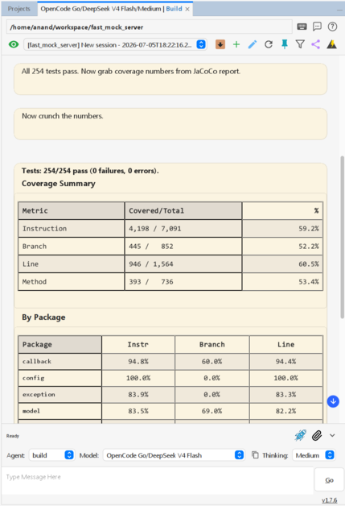
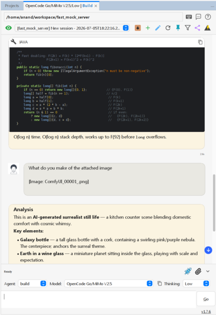
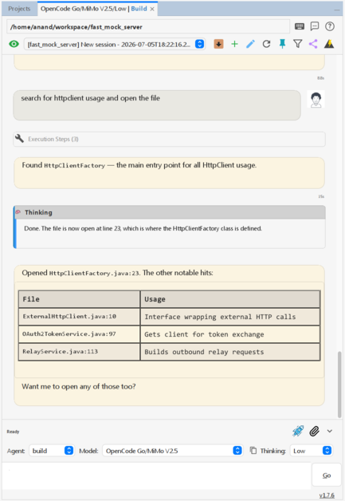

# BeanBot

[](pom.xml)
[](https://github.com/anandb/nb-complete)
[](https://central.sonatype.com/artifact/io.github.anandb/beanbot/versions)
[](https://netbeans.apache.org/download/index.html)
[](http://www.apache.org/licenses/LICENSE-2.0)
[](https://www.buymeacoffee.com/anandb)

> **An AI pair programmer that lives inside your NetBeans editor — ask, explain, generate, and refactor code without leaving the IDE.**

BeanBot is a NetBeans IDE plugin designed to provide integrated AI capabilities through the Agent Client Protocol (ACP). It offers a structured chat interface for technical assistance, including code generation, project analysis, and automated task execution.

| | | |
| :---: | :---: | :---: |
|  |  |  |

---

## Getting Started

Supported coding harnesses: **Goose, Oh My Pi, OpenCode, Codex, OpenClaw, Pi, Cursor, Copilot, Claude, Hermes, Gemini, Devin, Kilo Code, Cline, Jcode** — pick one during onboarding or later from the help menu.

**Token and cost statistics** are captured from the ACP traffic itself, not from an external process: the usage updates and per-turn token figures a harness already sends are recorded into an embedded H2 database under the NetBeans user directory (`beanbot/usage-stats.mv.db`), so they survive restarts and are readable without a harness running. The currency button in the toolbar opens the panel, which breaks the figures down by model and by agent; they are approximate for harnesses that report incomplete usage. Not all harnesses report usage as a monetary value.

**Project working directory (experimental)**: by default the ACP server keeps the working directory it started with, exactly as in 1.27.0 — switching to a session in another project never restarts it. Enabling *Options > BeanBot > Actions → Enable ACP server restart on project switch* binds the server to the session's project and restarts it on a switch; a restart terminates every session the running server serves. The option is read at startup, so changing it requires an IDE restart. This could be useful if you are running a containerized harness, and changing the project requires the workspace to be remounted.


### Installation from Source
1. Clone the repository:
   ```bash
   git clone https://github.com/anandb/nb-complete.git
   cd nb-complete
   ```
2. Build the package:
   ```bash
   ./mvnw package -DskipTests
   ```
3. Compiling the user guide needs [tweego](https://www.motoslave.net/tweego/) on the path.
3. The generated NBM will be located in the `./target/nbm/` directory.
4. Install the plugin through the Tools -> Plugins -> Downloaded tab.

### Dependency Security Scan

The `check-cvss` profile runs [OWASP Dependency-Check](https://jeremylong.github.io/DependencyCheck/) against the resolved dependencies:

```bash
export NVD_API_KEY=<your key>    # free from https://nvd.nist.gov/developers/request-an-api-key
./mvnw verify -Pcheck-cvss
```

The key is read from the `NVD_API_KEY` environment variable (or pass `-Dnvd.api.key=...`). Without a key the NVD feed is rate-limited heavily, so the first run is slow either way — it downloads the NVD dataset into the local Maven repository and caches it for later runs. Reports land in `target/dependency-check-report.html` and `.json`; accepted false positives belong in `scripts/dependency-check-suppressions.xml`.

---

## Architecture

The project follows a hexagonal (ports & adapters) architecture integrated into the NetBeans Platform:

- **`model/`**: ACP-compliant data records (sessions, messages, updates, config options). Zero dependencies on upper layers.
- **`contract/`**: Service interfaces that define ports for session control, process management, and UI callbacks. `manager/` implements; `ui/` consumes.
- **`manager/`**: Core orchestration — protocol client (JSON-RPC over stdin/stdout), session state machine, process lifecycle, and SSE strategy dispatch.
- **`mcp/`**: MCP server integration — hosts a local server that registers the IDE tool set (editor context and navigation, filesystem, git/hg, tasks, projects, stash diff) so that the AI client can inspect open tabs and control editor navigation.
- **`project/`**: NetBeans lifecycle hooks (`@OnStart`/`@OnStop`), the open-project manager, and the markdown project type.
- **`tasks/`**: todo.txt task repository integration — bugtracking providers, issue cache, task editors.
- **`support/`**: Pure utilities — logging, JSON mapping, text scanning, constants, browser helpers. Zero dependencies on upper layers.
- **`db/`**: H2 persistence layer — usage-stats store, session store, pinned-message and model-list caches, SQL loader, preference migration. Depends on `model/`, `support/`, `contract/`.
- **`pattern/`**: Compiled regex patterns as pure constants with no dependencies; consumed by all layers (ui, support, mcp, tasks, project, manager, db).
- **`ui/`**: All Swing components — chat window, message bubbles, streaming animation, theming, options panel, stash diff viewer. Depends on `contract/` interfaces, plus `model/` data records, `support/` utilities, and — through the `ui/platform/` bridge only — the `project/` layer. Never imports `manager/` or `mcp/`.

### Layer Dependencies

Dependencies flow downward only — no upward imports between layers:

```
        ┌─────────┐
        │   ui/   │  ← presentation (highest)
        └────┬────┘
             │
        ┌────▼────┐
        │manager/ │  ← business logic
        └────┬────┘
             │
    ┌────────┼────────┐
    ▼        ▼        ▼
┌────────┐ ┌────────┐ ┌────────┐
│ model/ │ │contract│ │support/│  ← data, interfaces, utils (lowest)
└────────┘ └────────┘ └────────┘
```

### Connection Flow

```
┌──────────┐    SSE / JSON-RPC    ┌───────────────────┐
│  Sidebar │ ◄──────────────────► │ AcpProtocolClient │
│ (client) │     stdin/stdout     │    (transport)    │
└──────────┘                      └────────┬──────────┘
                                           │
                                      ┌────▼──────┐
                                      │ ProcessMgr│
                                      │ (dispatch)│
                                      └────┬──────┘
                                           │
                                      ┌────▼──────┐
                                      │SessionMgr │
                                      │ (session) │
                                      └────┬──────┘
                                           │
                              ┌─────────────┼─────────────┐
                              ▼             ▼             ▼
                        ┌──────────┐  ┌──────────┐  ┌──────────┐
                        │ Strategy │  │ Lifecycle│  │   MCP    │
                        │ Registry │  │ Handler  │  │  Server  │
                        └──────────┘  └──────────┘  └──────────┘
```

`project/`, `mcp/`, `tasks/`, `db/`, and `pattern/` sit outside this five-layer model: `project/` is NetBeans
lifecycle wiring, `mcp/` is the tool-serving adapter surface, `tasks/` is a self-contained
bugtracking feature, `db/` is the H2 persistence adapter, and `pattern/` is a dependency-free
regex-constant satellite imported by every layer. `model/`, `contract/`, and `support/` import none
of `project/`, `mcp/`, or `tasks/`; `manager/` reaches `mcp/` only from `ProcessManager`
(via `McpManager`/`McpToolAdapter`).

---

## Source Organization

All source lives under `src/main/java/github/anandb/netbeans/`:

| Package | Files | Role |
| --- | --- | --- |
| `contract/` | 29 | Service interfaces (UI callbacks, session & process control, permission & request handlers, pinned message control) |
| `db/` | 8 | H2 persistence layer (usage-stats store, session store, pinned-message and model-list caches, SQL loader, preference migration) |
| `manager/` | 26 | Core orchestration, protocol clients, session management, process lifecycle (includes `strategy/`, file cache, VCS ignore) |
| `mcp/` | 44 | MCP server integration (editor, filesystem, VCS, task and project tool providers, tool input records, message servlet) |
| `model/` | 31 | ACP-compliant data models (session, messages, updates, config options, color tokens, usage records, harness catalog) |
| `pattern/` | 40 | Compiled regex patterns (pure constants, no dependencies; consumed by all layers) |
| `project/` | 12 | NetBeans lifecycle hooks, project manager (includes `mdproject/`, the markdown project type) |
| `support/` | 41 | Utilities (logging, JSON mapping, text scanning, constants, browser helpers, pinned message store, shortcut utils, binary resolution) |
| `tasks/` | 17 | todo.txt task repository integration (bugtracking providers, issue cache, task editors) |
| `ui/` | 137 | Swing components, platform integration, markdown project UI (chat, bubbles, theming, options, stash diff, file search, send-to-assistant actions) |

---

## Code Reading Path

For a guided walkthrough mapped to the plugin's execution flow, read files in this order:

### Phase 1: Entry & Lifecycle
1. [`project/ACPStartup.java`](src/main/java/github/anandb/netbeans/project/ACPStartup.java) — NetBeans `@OnStart` hook
2. [`project/ACPShutdown.java`](src/main/java/github/anandb/netbeans/project/ACPShutdown.java) — `@OnStop` cleanup
3. [`src/main/resources/github/anandb/netbeans/ui/layer.xml`](src/main/resources/github/anandb/netbeans/ui/layer.xml) — NetBeans registration (window menu/shortcuts, editor popup, Git toolbar); the Options panel is registered by annotation in `ui/ACPOptionsPanelController.java`

### Phase 2: Server Process
4. [`manager/ProcessManager.java`](src/main/java/github/anandb/netbeans/manager/ProcessManager.java) — Owns the ACP server subprocess and acts as the central request-dispatch hub; spawn itself is in `manager/ServerProcessLifecycle.startServer()`, launching the harness binary the user selected (15 supported)
5. [`support/BinaryResolver.java`](src/main/java/github/anandb/netbeans/support/BinaryResolver.java) — Locates the binary on PATH
6. [`manager/AcpProtocolClient.java`](src/main/java/github/anandb/netbeans/manager/AcpProtocolClient.java) — JSON-RPC over stdin/stdout, SSE read loop, pending request tracking

### Phase 3: Session Management
7. [`manager/SessionManager.java`](src/main/java/github/anandb/netbeans/manager/SessionManager.java) — Session CRUD, state machine, SSE routing
8. [`manager/SessionStateMachine.java`](src/main/java/github/anandb/netbeans/manager/SessionStateMachine.java) — Finite-state machine for session lifecycle
9. [`model/Session.java`](src/main/java/github/anandb/netbeans/model/Session.java) — Session data record
10. [`model/SessionUpdate.java`](src/main/java/github/anandb/netbeans/model/SessionUpdate.java) — SSE notification payload model
11. [`model/Message.java`](src/main/java/github/anandb/netbeans/model/Message.java) — Message model (prompts, tool calls, results)

### Phase 4: Strategy Dispatch (SSE handler chain)
12. [`contract/UIHandler.java`](src/main/java/github/anandb/netbeans/contract/UIHandler.java) — Callback interface for rendering
13. [`manager/strategy/StrategyRegistry.java`](src/main/java/github/anandb/netbeans/manager/strategy/StrategyRegistry.java) — Sole dispatch class: type switch routes `SessionUpdate` → extraction logic, eliminating the strategy interface hierarchy

### Phase 5: UI Rendering
14. [`ui/AssistantTopComponent.java`](src/main/java/github/anandb/netbeans/ui/AssistantTopComponent.java) — Main chat window (NetBeans TopComponent)
15. [`ui/ComponentLifecycleHandler.java`](src/main/java/github/anandb/netbeans/ui/ComponentLifecycleHandler.java) — Wires lifecycle events → managers
16. [`ui/SessionLifecycleHandler.java`](src/main/java/github/anandb/netbeans/ui/SessionLifecycleHandler.java) — Glue: receives SSE updates, calls `StrategyRegistry.handle()`, invokes UI
17. [`ui/ChatThreadPanel.java`](src/main/java/github/anandb/netbeans/ui/ChatThreadPanel.java) — Thread of message bubbles with streaming animation
18. [`ui/MessageBubble.java`](src/main/java/github/anandb/netbeans/ui/MessageBubble.java) — Individual message turn (thought, tool, code segments)
19. [`ui/MessageSender.java`](src/main/java/github/anandb/netbeans/ui/MessageSender.java) — Send/cancel logic

### Phase 6: Supporting
20. [`model/ProcessedMessage.java`](src/main/java/github/anandb/netbeans/model/ProcessedMessage.java) — The rendered output model consumed by UI
21. [`mcp/McpManager.java`](src/main/java/github/anandb/netbeans/mcp/McpManager.java) — MCP server integration layer
22. [`contract/RequestHandler.java`](src/main/java/github/anandb/netbeans/contract/RequestHandler.java) — Interface for incoming RPC requests from the server

---

## System Properties

The plugin reads the following system properties and environment variables:

| Property | System | Description |
|---|---|---|
| `user.dir` | System | **Not used.** `SessionManager` deliberately fails fast instead of falling back to the IDE launcher directory (`createSession` requires an explicit project `cwd`) |
| `user.home` | System | Default folder for Markdown Project creation (`MdProjectPanelVisual`) |
| `java.io.tmpdir` | System | Temp directory for pasted images (`ImagePasteTransferHandler`) |
| `os.name` | System | Detect Windows for binary resolution and platform-specific launching (`BinaryResolver`, `ProcessTerminator`, `ACPOptionsPanel`) |
| `beanbot.roundedPanels` | System (`true`) | Toggle rounded panel corners (`RoundedPanel`) |
| `beanbot.diff.ideFont` | System (`false`) | Apply the plugin's diff font (editor font − 1 pt, floor 9 pt) to the IDE's own diff windows, e.g. Git ▸ Show Changes (`ui/editor/IdeDiffFontHook`). Off by default because it patches another module's component tree; enable with `-J-Dbeanbot.diff.ideFont=true` in `netbeans.conf` |
| `beanbot.color.*` | System (varies) | Override any UI color. Read by `model/ColorRegistry` (resolution order: system property → `UIManager` key → built-in light/dark fallback), not by `ColorTheme`, which only loads `colors.json` |
| `beanbot.update.url` | System | Override the update metadata URL fetched by the update checker (`support/AppLinks`); defaults to `https://repo1.maven.org/maven2/io/github/anandb/beanbot/maven-metadata.xml` — lets a fork or self-hosted deployment serve its own `maven-metadata.xml` |
| `beanbot.nbm.base` | System | Base for the "Download Now" link, default `https://repo1.maven.org/maven2/io/github/anandb/beanbot`; the checker appends `/<version>/beanbot-<version>.nbm`, so it does not guess release-asset URLs |
| `beanbot.changelog.url` | System | Target of the "View Release Notes" link, default `https://github.com/anandb/nb-complete/blob/main/CHANGELOG.md` — points at the changelog so the link works before a release is tagged |
| `beanbot.support.url` | System | Funding link behind the bmc icon on the composer toolbar and the empty-state line (`support/AppLinks`); defaults to `https://buymeacoffee.com/anandb`, so a fork can point at its own page |
| `beanbot.issues.url` | System | Issue tracker behind Help ▸ Report an Issue (`support/AppLinks`); defaults to `https://github.com/anandb/nb-complete/issues/` |
| `beanbot.user.guide.url` | System | Override the user-guide URL opened from the help menu when the bundled guide cannot be served (`support/AppLinks`); unset means no remote fallback |
| `nb.dark.theme` | UIManager (Boolean) | Boolean dark-theme flag used for icon resolution (`IconResourceManager`); when absent, theme is inferred from `Panel.background` luminance |
| `ACP_WIRE_LOG` | Env | Path template for the ACP wire-protocol log (`WireLogger`). The file written is `<template-without-extension>_<YYYYMMDD>-<harness>.log` in the template's directory, so successive days and harnesses do not share one file. Every entry is one line: `<local time, no time zone> <json message>` |
| `PATH` | Env | Search path for the harness binary; every catalogued harness binary name is probed (`BinaryResolver`) |

The color properties are declared in [`colors.json`](src/main/resources/github/anandb/netbeans/ui/colors.json) and cover: background, foreground, selection, accent, sunken background, bubble (user/assistant), code, table, header, thinking, tool, permission, and error colors. Most entries define both light and dark variants; the ones resolved straight from a `UIManager` key or a single fallback (`foreground`, `sunkenBackground`, `codeBackground`, `codeForeground`, `codeSelection`) do not.

---

## Tasks File Format

BeanBot's **Tasks** repositories are plain [todo.txt](https://github.com/todotxt/todo.txt) files — one task per line, readable and editable with any standard todo.txt tool. BeanBot adds `id:`, `estimate:`, `consumed:` and `upd:` tokens to the standard `@tag` / `+project` / `due:` syntax. The full grammar, priority letters, round-trip guarantees and external-tool compatibility are documented in the bundled user guide — open the help icon in the toolbar and choose **Open User Guide**, then *Todo.txt Format*.

## Troubleshooting

| Problem | Solution |
| --- | --- |
| Plugin can't find the harness | Use the harness chooser to pick an installed harness, copy its install command, or set the path manually under `Options > BeanBot`. Binaries found on `PATH` are never auto-selected — you always make the choice. |
| Assistant becomes unresponsive | Click **Restart Harness** in the toolbar. |
| Ctrl + L stops working | Close and reopen the assistant panel from the Window menu. If that doesn't work, restart the IDE. |
| Sidebar doesn't open after install/upgrade | The plugin auto-opens the sidebar on version change. If it doesn't appear, open it from `Window > Assistant`. |
| Image paste doesn't work with Wayland on Linux | Install the `wl-clipboard` package (Wayland) or check your clipboard manager. |
| Image paste broken after OpenCode upgrade | Upgrade to OpenCode >= 1.17.17 to resolve the breakage introduced in v1.17.13. |
| Model not appearing after an OpenCode upgrade | Re-select your model via `/models`. An upgrade that changes the `thought_level` split resets model selection. |
| Session config payloads restructured after upgrade | Upgrade to BeanBot >= 1.21.1 and OpenCode >= 1.17.17. Re-select your model and review any custom preamble or session settings. |
| Messages disappear from view | This is display-only — the session still has all messages. Click **Show All Messages** to keep them visible, and use **Reload** to re-fetch from the server. |
| LLM modified files unexpectedly | Keep your project under version control so you can revert changes you don't want. You can also set OpenCode to 'ask' before editing, and review changes with the **Allow Once/Always Allow/Reject** permission prompts. There is also a setting — **Auto-backup uncommitted changes on turn start (git/hg)** (Options > BeanBot) — that stashes a copy of uncommitted changes before each turn, so the AI's edits can be rolled back safely. |
| Panel goes blank during docking or resizing | Close and reopen the docked panel from `Window > Assistant`. NetBeans may not repaint correctly after a drag-dock or undock operation. |

## Known Issues/Limitations

- The plugin supports only one active session at a time, switching sessions or reloading the conversation while awaiting a response will cancel the current request.
- OpenCode doesn't always relay permission requests from subagents (delegated agents) back to the UI. If a subagent makes a tool call that requires permission, the request may hang and eventually time out because you never receive the Accept/Deny prompt. To mitigate this, instruct the agent to perform file modifications or commands directly rather than asking it to delegate those tasks to a subagent. The mini-assistant also shows permission prompts — check whether that is visible if the main sidebar doesn't show one.
- A few harnesses like Pi write directly to files; the pi-permission extension can gate some of those actions.
- A lot of the functionality relies on the harness, some like Gemini don't support changing the model once the session has begun, others like OpenClaw implement a very barebones subset of the specification.

---

## Contributing

Development follows standard NetBeans Platform patterns. Contributors are expected to maintain consistency with existing styling and logging conventions. New components must be validated against both light and dark IDE themes.

---

## License

This software is released under the Apache License, Version 2.0. Further details can be found in the LICENSE file.


## Support

If you find BeanBot useful, consider [sponsoring](https://www.buymeacoffee.com/anandb) the project to support its continued development and maintenance.

BeanBot is free and open source. Donations are entirely optional, and using the project does not require payment.
