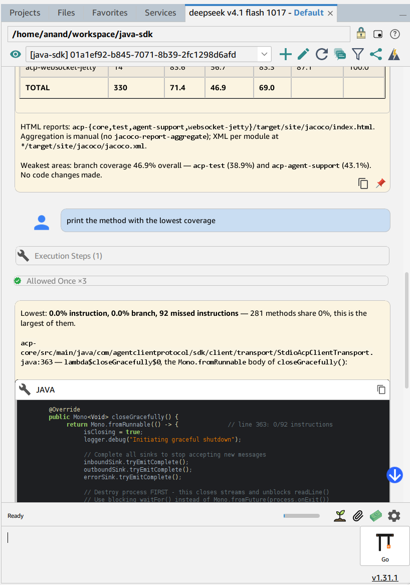
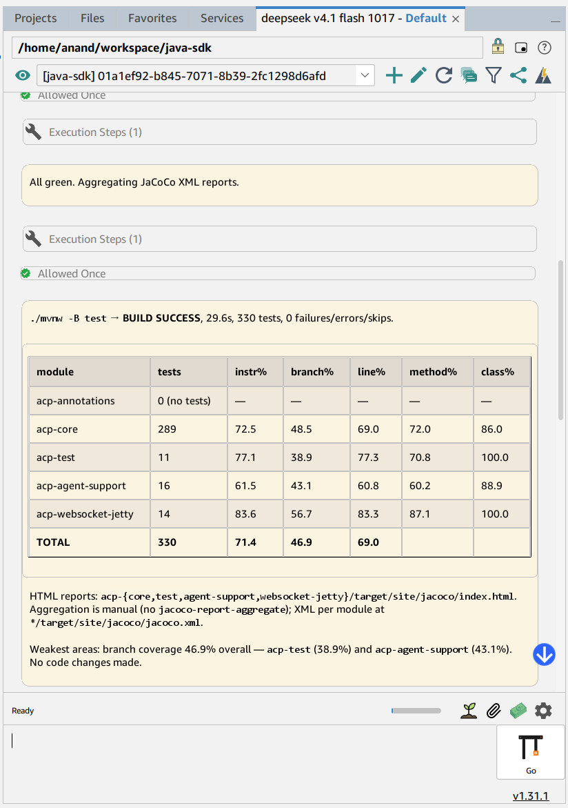
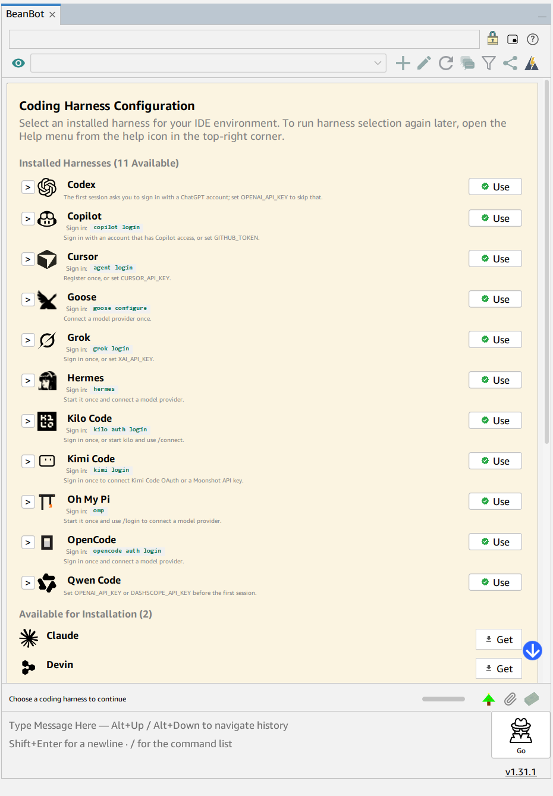
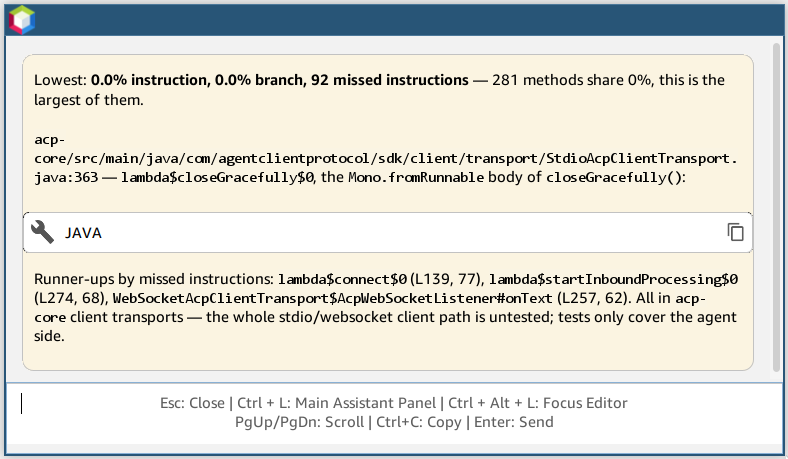
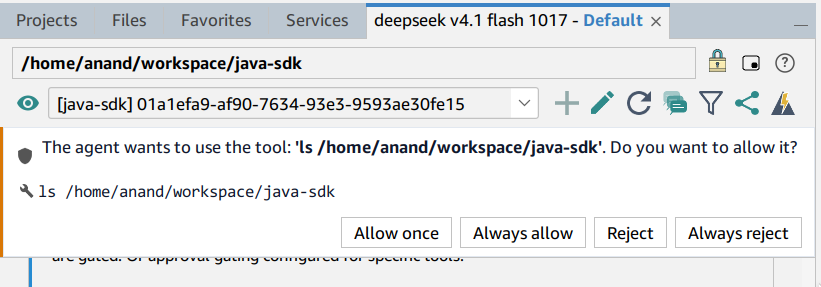

# BeanBot

[](pom.xml)
[](https://github.com/anandb/nb-complete)
[](https://central.sonatype.com/artifact/io.github.anandb/beanbot/versions)
[](https://netbeans.apache.org/download/index.html)
[](http://www.apache.org/licenses/LICENSE-2.0)
[](https://www.buymeacoffee.com/anandb)

<p align="center">
  <strong>An agentic coding environment, integrated into NetBeans.</strong><br>
  Bring Claude, OpenCode, Codex, Gemini, Goose and other coding harnesses into your NetBeans workflow.
</p>

**Code with AI. Stay in your IDE.**

BeanBot brings agentic coding assistants directly into Apache NetBeans. Chat with your coding agent,
explore projects, modify files, inspect changes and use IDE-aware tools without constantly switching
between applications.

- **Multiple coding harnesses** through the Agent Client Protocol (ACP).
- **IDE-aware tools** through the Model Context Protocol (MCP).
- **Streaming conversations** with interactive tool execution and permission prompts.
- **Project, filesystem, editor and version-control integration**.
- **Token and cost tracking** for the traffic your harness reports.
- **Integrated task management** with plain todo.txt repositories.

| | | |
| :---: | :---: | :---: |
|  |  |  |
| Chat and tool activity | Table rendering | Harness selection |

---

## Why BeanBot?

| | |
| --- | --- |
| **One assistant, many agents** | Pick the harness you already pay for — Claude, OpenCode, Codex, Gemini, Goose, Cursor, Copilot, Cline and more — without changing editors. |
| **Agentic, not autocomplete** | Agents read project context, navigate the editor, run tools and return diffs instead of suggesting a few lines. |
| **The IDE is the toolbelt** | An embedded MCP server exposes open projects, editor context, file search, Git/Mercurial and stash diffs to the agent. |
| **Understand what it costs** | Per-turn usage that the harness reports is persisted locally and broken down by model and agent. |
| **Stays out of the way** | Streaming chat, collapsible tool/thought panes, a mini assistant, and a compact layout. |
| **Local data, your harness** | BeanBot does not call model APIs itself; credentials and configuration stay with the harness you already use. |

## Features

### Agentic chat

- Work with any supported harness over ACP and switch when you need to.
- Stream responses, thoughts and tool calls; expand or collapse activity per turn.
- Manage sessions, rename, archive, reload and export conversations.
- Rich rendering for Markdown, tables and code blocks.

### IDE integration

- Editor context, navigation and open-file awareness.
- Project and filesystem tools guarded by the same access policy as ACP requests.
- Git and Mercurial status, diffs, file history and stash browsing.
- Stash diff viewer, jump-to-file, send-to-assistant actions and inline permission prompts.

### Usage and cost tracking

Token and cost statistics are captured from the ACP traffic itself: the usage updates and per-turn
figures a harness already sends are recorded into an embedded H2 database under the NetBeans user
directory (`beanbot/usage-stats.mv.db`), so they survive restarts and are readable without a harness
running. Figures are approximate for harnesses that report incomplete usage; not every harness
reports a monetary value.

### Productivity

- Task repositories backed by plain [todo.txt](https://github.com/todotxt/todo.txt) files, with
  `id:`, `estimate:`, `consumed:` and `upd:` tokens on top of `@tag`/`+project`/`due:` syntax. The
  full grammar is in the bundled user guide (*Todo.txt Format*).
- Markdown project support.
- File search, editor actions and a mini assistant window.
- Light and dark themes with configurable chat colours and fonts.

## Supported coding harnesses

BeanBot uses the Agent Client Protocol (ACP) to connect NetBeans with a growing ecosystem of AI
coding agents. Pick a harness during onboarding, or later from the help menu in the toolbar.

| Harness | Harness | Harness |
| --- | --- | --- |
| [Oh My Pi](https://omp.sh/docs/acp) | [OpenCode](https://opencode.ai/docs/) | [Codex](https://github.com/agentclientprotocol/codex-acp) |
| [OpenClaw](https://docs.openclaw.ai/install) | [Pi](https://github.com/georgeharker/pi-acp) | [Goose](https://goose-docs.ai/docs/getting-started/installation) |
| [Cursor](https://cursor.com/docs/cli/acp) | [Copilot](https://github.com/github/copilot-cli) | [Claude](https://github.com/agentclientprotocol/claude-agent-acp) |
| [Hermes](https://hermes-agent.nousresearch.com/docs/user-guide/features/acp) | [Gemini](https://geminicli.com/docs/get-started/installation/) | [Devin](https://docs.devin.ai/cli) |
| [Kilo Code](https://kilo.ai/docs/code-with-ai/platforms/cli) | [Cline](https://docs.cline.bot/usage/acp) | [Jcode](https://jcode.sh/docs) |
| [Qwen Code](https://qwenlm.github.io/qwen-code-docs/) | [Kimi Code](https://moonshotai.github.io/kimi-code/) | [Grok](https://x.ai/cli) |
| [OpenHands](https://docs.openhands.dev/openhands/usage/run-openhands/acp) | | |

Some harnesses expose only a subset of ACP; the plugin shows their limitations in the UI. The catalog
is defined in `src/main/resources/github/anandb/netbeans/model/harness-catalog.yaml`.

## Getting Started

### Prerequisites

- Apache NetBeans 22 or later (developed against RELEASE220)
- At least one supported coding harness, installed and authenticated separately

### Installation

1. Download the latest `beanbot-<version>.nbm` from
   [Maven Central](https://repo1.maven.org/maven2/io/github/anandb/beanbot/) or
   [GitHub Releases](https://github.com/anandb/nb-complete/releases).
2. In NetBeans, open **Tools → Plugins → Downloaded**.
3. Click **Add Plugins…**, select the downloaded NBM and complete the installation.
4. Restart NetBeans when prompted.

Updates after installation are offered from the same Maven Central metadata.

### First launch

1. Open **Window → Assistant** (or press `Ctrl+L`).
2. Choose an installed harness, or follow the install command shown for one.
3. Complete the harness authentication if necessary.
4. Open a project and start chatting.

To run harness selection again, open the help menu from the help icon in the top-right corner.

### Build from source

```bash
git clone https://github.com/anandb/nb-complete.git
cd nb-complete
./mvnw package -DskipTests
```

The NBM is written to `target/nbm/`. Full build, test and user-guide instructions are in
[DEVELOPMENT.md](docs/DEVELOPMENT.md).

## How it works

BeanBot is an ACP client: it launches the selected harness as a subprocess and speaks JSON-RPC over
stdin/stdout, consuming streamed `session/update` notifications. In the other direction, an embedded
MCP server exposes IDE tools so the agent can inspect projects and act inside the editor.

```
┌──────────────────┐   JSON-RPC / stdio   ┌──────────────────────┐
│  NetBeans chat   │ ◄──────────────────► │ Harness (ACP agent)  │
│  sidebar / UI    │                      │ Claude, OpenCode, …  │
└────────┬─────────┘                      └──────────┬───────────┘
         │                                           │
         │ MCP tool calls                            │
         ▼                                           ▼
┌───────────────────────────────────────────────────────────────┐
│ Embedded MCP server: projects, files, editor, Git/Hg, tasks   │
└───────────────────────────────────────────────────────────────┘
```

More detail: [ARCHITECTURE.md](docs/ARCHITECTURE.md).

## Screenshots

| | |
| :---: | :---: |
|  |  |
| Mini assistant | Tool permission request |

## FAQ

**Does BeanBot include an API key or model?** No. It drives a coding harness you install and
authenticate; BeanBot itself makes no model calls.

**Can I use more than one harness?** Yes, but one session is active at a time. Switching a session or
reloading the conversation while a response is pending cancels the current request.

**Where is my data stored?** Harness configuration and credentials stay with the harness. BeanBot
stores usage statistics, session metadata and pins under `beanbot/` in the NetBeans user directory.

**Is the usage cost exact?** It is derived from what the harness reports and is approximate when the
harness reports incomplete usage.

**A harness is not detected.** Set the path manually under **Options → BeanBot**, or use the harness
chooser to install or pick it. Binaries on `PATH` are never auto-selected.

**Something is broken.** See [TROUBLESHOOTING.md](docs/TROUBLESHOOTING.md), or use
**Help → Report an Issue**.

## For developers

- [ARCHITECTURE.md](docs/ARCHITECTURE.md) — package layout, layer rules and connection flow.
- [ARCHITECTURE-REVIEW.md](docs/ARCHITECTURE-REVIEW.md) — long-form design review and subsystem notes.
- [architecture.dot](docs/architecture.dot) — generated component graph.
- [DEVELOPMENT.md](docs/DEVELOPMENT.md) — build, tests, source organization, code reading path and
  system properties.
- [AGENTS.md](AGENTS.md) — repository coding rules and architectural constraints.

BeanBot is a NetBeans Platform plugin built with the pinned Maven wrapper. `model/` is a
dependency-free leaf; `contract/` defines the ports; `ui/` and `manager/` are peers over those ports,
and `mcp/`, `db/`, `tasks/` and `project/` are satellites that depend downward only.

## Contributing

Contributions are welcome. Keep changes consistent with the existing NetBeans Platform patterns,
styling and logging conventions, and validate new components against both light and dark themes.
Read [DEVELOPMENT.md](docs/DEVELOPMENT.md) and [AGENTS.md](AGENTS.md) first.

## License

This software is released under the Apache License, Version 2.0. Further details can be found in the
[LICENSE](LICENSE) file.

## Support

If you find BeanBot useful, consider [supporting](https://www.buymeacoffee.com/anandb) the project to
support its continued development and maintenance. BeanBot is free and open source. Donations are
entirely optional, and using the project does not require payment.
